# Worker WageBook 📱💼

<div align="center">
  
  <br /><br />

  **A modern, offline-first mobile application for managing worker attendance, cash advances, weekly wages, and mid-week differential salary settlements.**

  Designed for construction contractors, factory supervisors, site managers, and small-to-medium business owners who employ daily and weekly wage workers.

  <p align="center">
    <a href="https://expo.dev/artifacts/eas/jMvl-fJoQ7g2plC2UIaEs3pzuvOv4Z8B_yDmldYIkqE.apk"></a>
    <a href="https://expo.dev/accounts/world_dominator/projects/worker-wagebook/builds/b77cd3ec-da9e-4edf-b449-2ca3926879ce"></a>
  </p>

  <p align="center">
    
    
    
    
    
    
  </p>
</div>

---

## 📥 Direct Download (Android APK)

You can download and install the standalone preview APK directly on any Android device without Google Play Console or Expo Go:

- **Direct APK Download**: [⬇️ Download Worker WageBook v1.0.0 APK](https://expo.dev/artifacts/eas/jMvl-fJoQ7g2plC2UIaEs3pzuvOv4Z8B_yDmldYIkqE.apk)
- **EAS Cloud Build Logs**: [🔗 View EAS Build #b77cd3ec](https://expo.dev/accounts/world_dominator/projects/worker-wagebook/builds/b77cd3ec-da9e-4edf-b449-2ca3926879ce)

### Installation Instructions
1. Download the  file using the link above on your Android phone.
2. Tap the downloaded file to install.
3. If prompted by Android, enable **"Install from unknown sources"** for your browser or file manager.
4. Launch **Worker WageBook**, complete the initial 1-minute business setup, set your 4-digit security PIN, and start managing your workforce immediately!

---

## 👨‍💻 Developer & Credits

- **Lead Developer**: **Vishal G**
- **Email**: [vishalgovindasamy@gmail.com](mailto:vishalgovindasamy@gmail.com)
- **Technology & Platform**: React Native, Expo, SQLite, TypeScript
- **Design Standard**: Custom High-Density Design System inspired by Linear, Khatabook, and Material Design

---

## 📑 Table of Contents

- [Why Worker WageBook?](#-why-worker-wagebook)
- [Key Features](#-key-features)
- [Visual Showcase & Screenshots](#-visual-showcase--screenshots)
  - [Onboarding & Security PIN](#1-onboarding--security-pin)
  - [Dashboard & Attendance Marking](#2-dashboard--attendance-marking)
  - [Worker Management & Monthly Calendar](#3-worker-management--monthly-calendar)
  - [Salary Settlement & Mid-Week Differential Payouts](#4-salary-settlement--mid-week-differential-payouts)
  - [Reports, Dark Theme & Administration](#5-reports-dark-theme--administration)
- [Core Functional Modules](#-core-functional-modules)
  - [1. Security & Authentication](#1-security--authentication)
  - [2. Worker Directory](#2-worker-directory)
  - [3. Daily Attendance & Overtime Engine](#3-daily-attendance--overtime-engine)
  - [4. Advances & Balance Tracking](#4-advances--balance-tracking)
  - [5. Salary Settlement Engine & Mid-Week Payouts](#5-salary-settlement-engine--mid-week-payouts)
  - [6. Aligned 7-Column Monthly Calendar](#6-aligned-7-column-monthly-calendar)
  - [7. Reports & PDF/CSV Export](#7-reports--pdfcsv-export)
  - [8. Dark Theme & Accessibility](#8-dark-theme--accessibility)
  - [9. Gesture & 3-Button Navigation](#9-gesture--3-button-navigation)
  - [10. Factory Reset & Data Management](#10-factory-reset--data-management)
- [Technology Stack](#-technology-stack)
- [Database Architecture](#-database-architecture)
- [Project Structure](#-project-structure)
- [Getting Started (Development)](#-getting-started-development)
- [Building with EAS](#-building-with-eas)
- [License](#-license)

---

## 🌟 Why Worker WageBook?

Managing daily wage workers using paper notebooks (khatas) or generic spreadsheets is tedious, error-prone, and vulnerable to loss:
- Workers often request cash advances in the middle of the week.
- Workers sometimes need partial wage payments mid-week, leaving managers confused about how much is owed for remaining days.
- Overtime calculations are disputed due to a lack of real-time timestamped records.
- Generic payroll tools are cloud-dependent, slow, bloated with corporate HR features, or require monthly subscriptions.

**Worker WageBook** is purpose-built to solve these exact problems. It is **100% offline-first**, blisteringly fast, guarded by a **4-digit PIN**, and features an innovative **differential settlement engine** that seamlessly handles mid-week payments without double payouts or accounting discrepancies.

---

## ⚡ Key Features

| Capability | What It Does |
| :--- | :--- |
| **100% Offline-First** | All data resides in a local SQLite database on your device. Zero internet required to mark attendance, calculate salaries, or generate reports. |
| **4-Digit Security PIN** | App is protected by a 4-digit PIN with inactivity auto-lock (5 mins) and PIN protection on sensitive actions (Delete Worker, Factory Reset). |
| **Worker Directory** | Auto-generates sequential IDs (`W-001`, `W-002`...), stores categories, phone numbers, wage rates, and photos. |
| **Dynamic Filter Chips** | Category filters in the Workers list automatically hide categories with no active workers, preventing empty screens. |
| **Live Attendance Timestamps** | Marks attendance with 1-tap presets and records dynamic time badges (e.g., *"Marked at 02:45 PM"*). Full edit history with mandatory audit reasons. |
| **Flexible Overtime** | Track overtime by **Hours** (with configurable 1.5x multiplier) or flat **Rupee Cash Amount** per day. |
| **Advance Carry-Forward** | Cash advances are tracked per worker and automatically carried forward across weeks until settled. |
| **Mid-Week Differential Pay** | Pay workers on any day of the week. Future attendance in the same week calculates only remaining differential balance, preventing duplicate payments! |
| **7-Column Monthly Calendar** | True grid layout (Mon–Sun) with empty leading offsets for accurate day alignment, color-coded badges, and monthly stats. |
| **PDF & CSV Reports** | Export professional branded PDF reports (Salary Register, Attendance, Advances, Cashbook) and CSV worker rosters. |
| **Light & Dark Theme** | Fully tuned light and high-contrast dark theme with sharp, readable text across all cards and controls. |
| **Mobile Navigation Ready** | Fully tested with modern Android Gesture Navigation and traditional 3-Button Navigation bars (`edge-to-edge`). |
| **Factory Reset** | PIN-gated danger zone option to wipe local database and re-initialize as a brand new app. |

---

## 📸 Visual Showcase & Screenshots

### 1. Onboarding & Security PIN

| Business Setup Onboarding | 4-Digit Security PIN Lock |
| :---: | :---: |
| 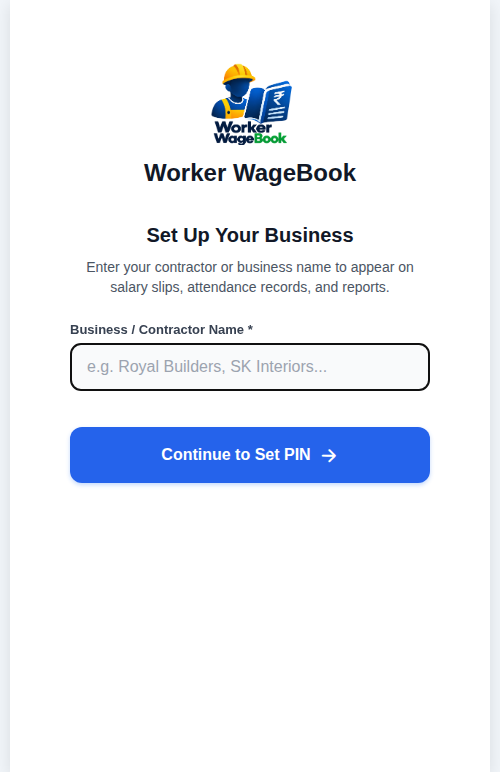 | 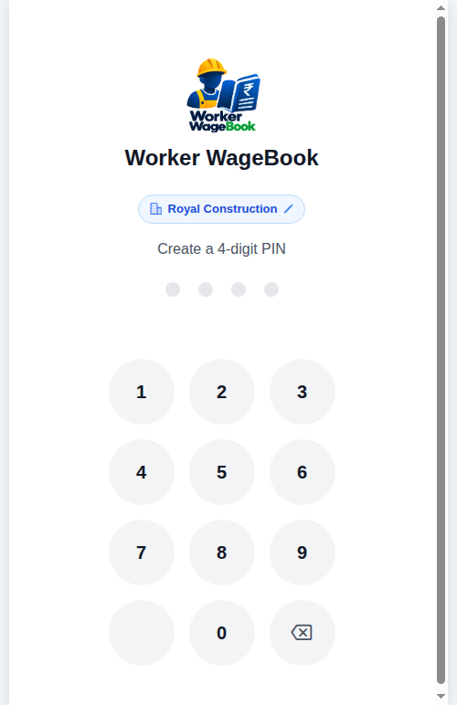 |
| *First-time launch setup for business name, owner info, and week start day.* | *Clean, distraction-free 4-digit PIN security lock with auto-lock protection.* |

---

### 2. Dashboard & Attendance Marking

| Home Dashboard (Light) | Daily Attendance with Timestamps | Overtime Drawer (Hours & Cash) |
| :---: | :---: | :---: |
| 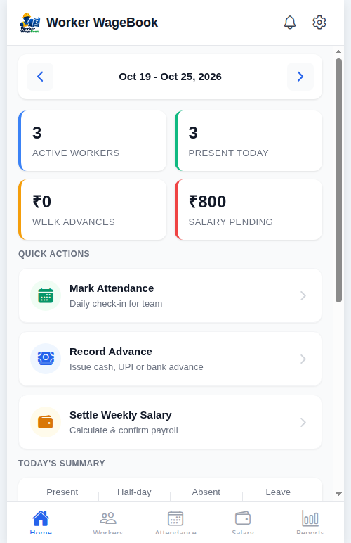 | 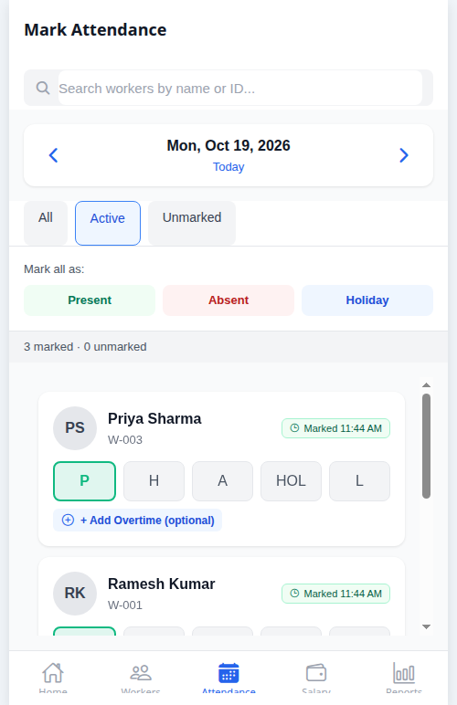 | 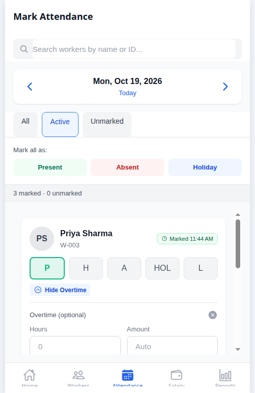 |
| *Weekly summary, quick actions, attendance ratios, and outstanding advances.* | *Fast 1-tap status selection with live "Marked at..." timestamp badges.* | *Expandable overtime drawer supporting both hourly multipliers and flat cash amounts.* |

---

### 3. Worker Management & Monthly Calendar

| Dynamic Category Filter | 7-Column Monthly Calendar | Delete Worker PIN Confirmation |
| :---: | :---: | :---: |
| 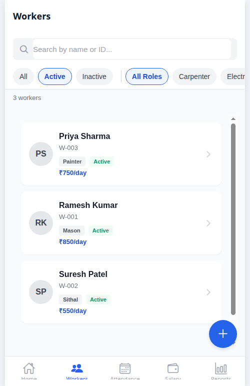 | 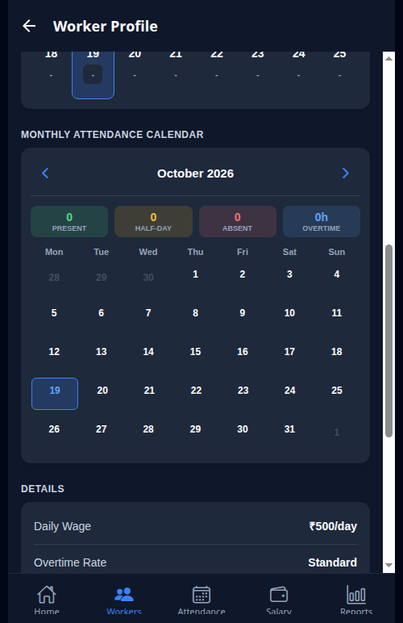 | 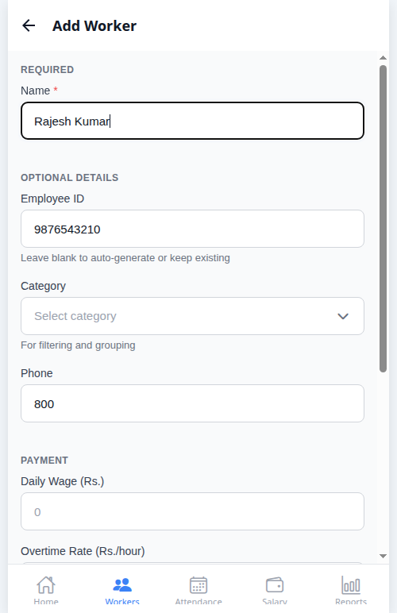 |
| *Filter chips only show categories with active workers. Instant search by name or ID.* | *Aligned 7-column grid (Mon–Sun) with color-coded status badges and monthly totals.* | *Security PIN prompt prevents accidental deletion of worker records.* |

---

### 4. Salary Settlement & Mid-Week Differential Payouts

| Weekly Salary Overview | Mid-Week Differential Settlement |
| :---: | :---: |
| 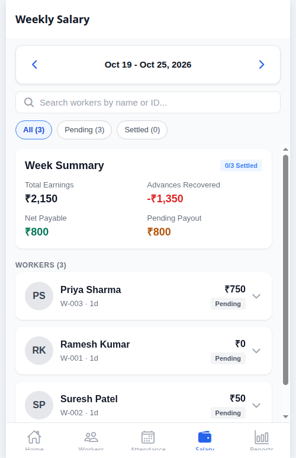 | 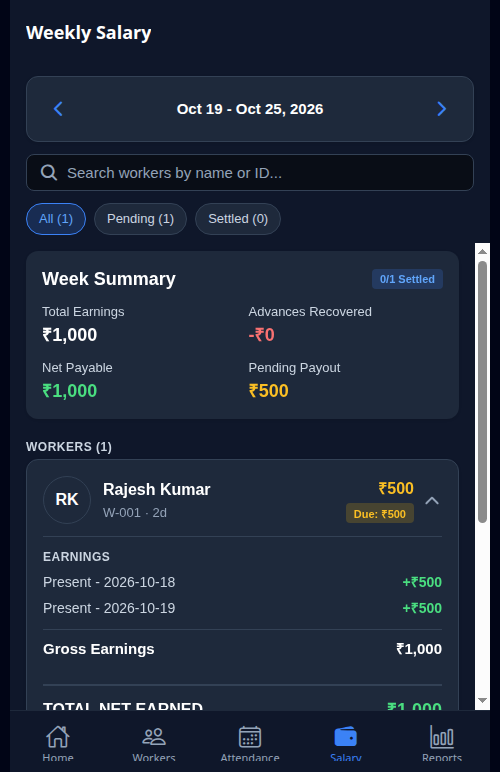 |
| *Comprehensive breakdown: Base Earnings + Overtime - Advance Recovery = Net Payable.* | *Unique "Pay Remaining" button calculates only unsettled differential earnings.* |

---

### 5. Reports, Dark Theme & Administration

| Reports Hub (PDF & CSV) | High-Contrast Dark Theme | Factory Reset Protection |
| :---: | :---: | :---: |
| 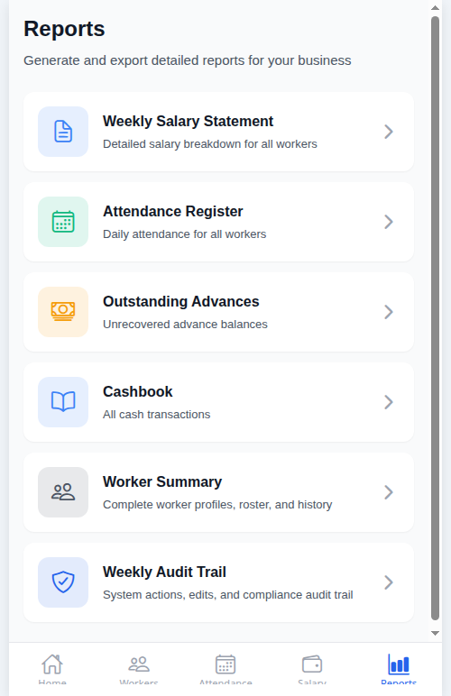 | 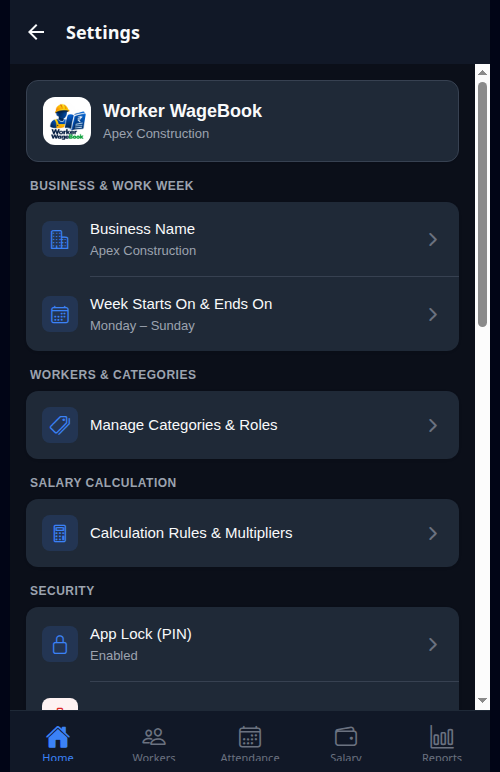 | 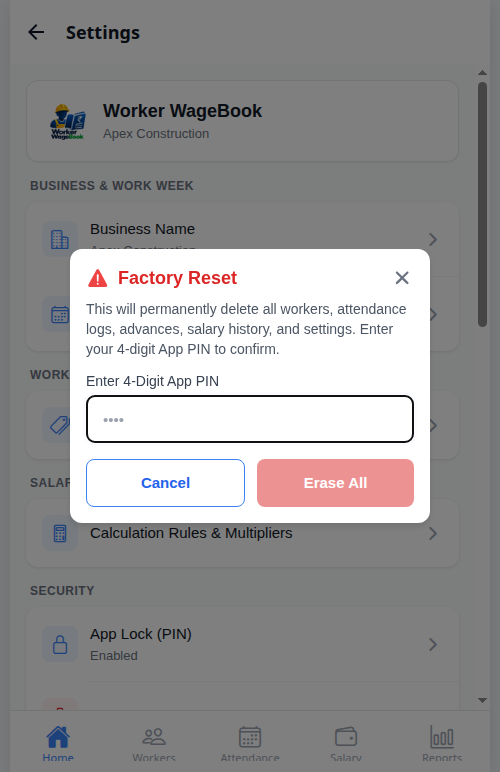 |
| *Export Salary Slips, Attendance Registers, Advances, and Cashbook summaries to PDF.* | *Polished Dark Mode with carefully calibrated contrast for bright outdoor job sites.* | *PIN-guarded Danger Zone to safely wipe all local data and reset to initial state.* |

| Dark Mode Attendance | Dark Mode Calendar | Developer Information |
| :---: | :---: | :---: |
| 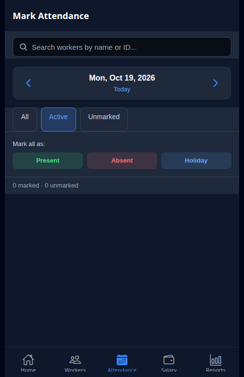 | 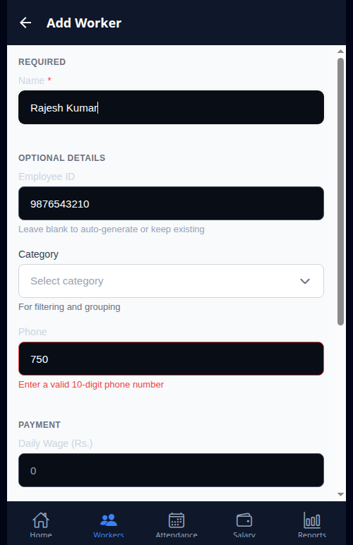 | 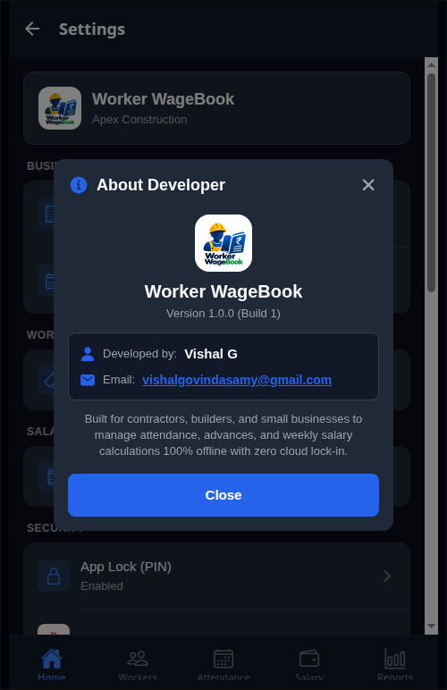 |
| *Attendance marking in dark mode with legible contrast and sharp icons.* | *7-column monthly grid rendered in dark mode with color-coded indicators.* | *About developer modal with contact details for Vishal G.* |

---

## 🔍 Core Functional Modules

### 1. Security & Authentication
- **Initial Setup**: First-time users set a 4-digit PIN along with their business name.
- **Inactivity Auto-Lock**: Automatically locks the app after 5 minutes of background/inactivity to protect sensitive wage data.
- **Action Guards**: Critical actions like deleting a worker or performing a factory data reset require PIN verification before execution.
- **Change PIN**: Change your security PIN at any time from **Settings > Security & PIN**.

### 2. Worker Directory
- **Sequential IDs**: Automatic employee numbering (`W-001`, `W-002`, `W-003`...).
- **Profiles**: Store full name, contact number, category, daily wage rate, joining date, and avatar photo.
- **Active-Only Category Filters**: Horizontal filter chips dynamically populate based only on categories that currently contain active workers. Categories with 0 workers are cleanly omitted.
- **Safe Worker Deletion**: Replaces generic deactivation with an explicit "Delete Worker" workflow guarded by a 4-digit PIN confirmation modal.

### 3. Daily Attendance & Overtime Engine
- **Attendance Statuses**:
  - `Present`: Full daily wage
  - `Half Day`: Configurable fraction (default `0.5x`)
  - `Absent`: Zero wage
  - `Holiday`: Paid holiday multiplier (default `1.0x`)
  - `Weekly Off`: Paid weekly off multiplier (default `1.0x`)
  - `Leave`: Approved leave tracking
- **Real-Time Timestamps**: Displays exact time of marking (e.g., *"Marked at 08:30 AM"*).
- **Overtime Tracking**:
  - Hourly OT: Enter overtime hours; calculated as `(daily_wage / 8) * hours * 1.5`.
  - Cash OT: Enter a direct rupee amount (e.g. `₹250`) directly added to gross earnings.
- **Audit Logging**: Any attendance edit requires an explanation reason, recorded in `attendance_edits` with previous status, new status, timestamp, and reason.

### 4. Advances & Balance Tracking
- Record cash advances given to workers on any date with an optional note/reason.
- Displays real-time **Outstanding Balance** for every worker on their profile and in the Salary Settlement screen.
- Advances carry forward automatically across weeks until fully recovered through confirmed weekly salary settlements.

### 5. Salary Settlement Engine & Mid-Week Payouts
The salary engine calculates:
- **Gross Earnings**: Sum of (`Daily Wage` × `Status Multiplier`) + `Overtime Earnings`
- **Advance Recovery**: Minimum of (`Outstanding Advances`, `Gross Earnings` × `Max Recovery %`)
- **Net Payable**: `Gross Earnings` - `Advance Recovery` *(Guaranteed: Net Pay is never negative)*

#### The Mid-Week Differential Settlement Innovation:
In real-world job sites, a worker might request payment on Wednesday instead of waiting for the weekend. In conventional apps, paying on Wednesday creates problems: marking attendance on Thursday and Friday either zeroes out or double-counts the week.
- **How Worker WageBook Solves This**:
  1. If a worker is paid on Wednesday, the app records a locked settlement up to Wednesday.
  2. When attendance is marked on Thursday, the engine identifies that a prior settlement exists for this week.
  3. It automatically calculates only the **differential earnings** earned after Wednesday, along with any newly taken advances.
  4. The UI displays the remaining balance with a **"Pay Remaining"** button instead of "Confirm & Pay".
  5. Upon confirmation, a differential settlement item is recorded without duplicate payouts or balance erasure!

### 6. Aligned 7-Column Monthly Calendar
- Located in each worker's profile under the **Monthly Calendar** tab.
- **True Calendar Grid**: Computes the first day of the selected month and places empty offset cells so the 1st of the month falls on the exact day of the week (Mon–Sun).
- **Day Badges**: Color-coded circles indicating Present (Green), Half Day (Orange), Absent (Red), Holiday (Blue), Weekly Off (Purple), Leave (Yellow).
- **Summary Header**: Displays total Present days, Half days, Absent days, and Overtime hours for that month.

### 7. Reports & PDF/CSV Export
- **Weekly Salary Register**: Line-by-line breakdown of attendance, overtime, gross pay, advance recovery, and net payable.
- **Attendance Register**: Daily status register for all workers across the selected week.
- **Outstanding Advances**: Summary of all workers who have active advance debt.
- **Cashbook Outflow**: Weekly accounting log of total cash disbursed (advances + net salaries).
- **Professional PDF Export**: Generated using `expo-print` with clean HTML tables, business name, and print date.
- **CSV Import/Export**: Export worker rosters to CSV or import bulk workers with validation.

### 8. Dark Theme & Accessibility
- **Theme Selector**: Choose between **Light** and **Dark** mode in **Settings > Appearance**.
- **WCAG-Compliant Contrast**: Text, subheadings, chips, and borders are carefully calibrated with `#E0E0E0` and `#FFFFFF` on dark backgrounds (`#121212` and `#1E1E1E`), ensuring complete legibility even in bright sunlight.
- **Consistent Tokens**: Centralized color palette in `theme.ts` applied across all screens, modals, and list items.

### 9. Gesture & 3-Button Navigation
- Wrap-around with `GestureHandlerRootView` and `SafeAreaProvider`.
- Full compatibility with:
  - Modern Android edge-to-edge gesture navigation (back swipe, home swipe).
  - Classic Android 3-button navigation bars (Back, Home, Recents).
- Tab bar and modals have bottom padding to prevent system navigation bar overlap.

### 10. Factory Reset & Data Management
- Accessible in **Settings > Danger Zone**.
- Prompts for the 4-digit security PIN.
- Purges all tables, drops the SQLite database, resets the in-memory store, and transitions back to the initial Business Setup onboarding flow.

---

## 🛠 Technology Stack

| Layer | Technologies |
| :--- | :--- |
| **Mobile Framework** | [React Native 0.81](https://reactnative.dev/) with [Expo SDK 54](https://expo.dev/) |
| **Language** | [TypeScript 5.9](https://www.typescriptlang.org/) |
| **Local Database** | [expo-sqlite](https://docs.expo.dev/versions/latest/sdk/sqlite/) (SQLite 3 with Foreign Keys) |
| **Navigation** | [@react-navigation/native-stack](https://reactnavigation.org/) + [@react-navigation/bottom-tabs](https://reactnavigation.org/) (v7) |
| **State Management** | [Zustand](https://github.com/pmndrs/zustand) (with persistent storage hooks) |
| **Date & Time** | [date-fns](https://date-fns.org/) |
| **Document & PDF** | [expo-print](https://docs.expo.dev/versions/latest/sdk/print/) + [expo-sharing](https://docs.expo.dev/versions/latest/sdk/sharing/) |
| **Icons** | [@expo/vector-icons (MaterialIcons)](https://icons.expo.fyi/) |
| **Build Tooling** | [EAS Build (Expo Application Services)](https://expo.dev/eas) |

---

## 🗄 Database Architecture

Worker WageBook operates entirely on an embedded SQLite database (`wagebook.db`) with relational integrity and foreign keys enabled:

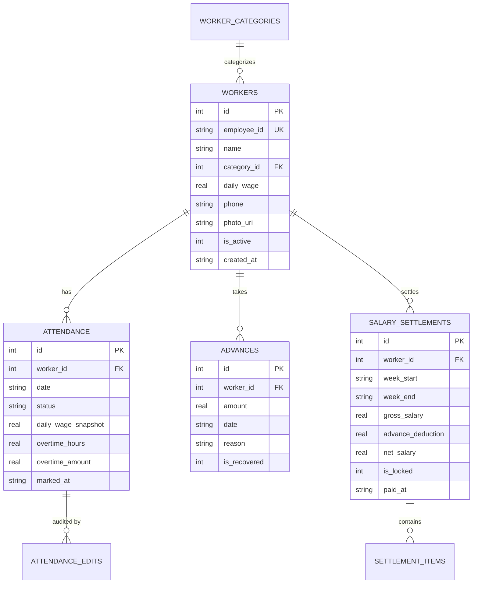

### Database Tables Breakdown

| Table | Purpose | Key Constraints |
| :--- | :--- | :--- |
| `workers` | Master worker directory with auto-generated IDs | `UNIQUE(employee_id)`, `is_active IN (0,1)` |
| `worker_categories` | Custom worker skill categories | `name TEXT NOT NULL`, default wage rate |
| `attendance` | Daily attendance and snapshot wages | `UNIQUE(worker_id, date)`, FK to `workers` |
| `attendance_edits` | Full audit trail of modified attendance records | Old status, new status, timestamp, mandatory edit reason |
| `advances` | Cash advances disbursed to workers | Amount, date, reason, recovery tracking |
| `salary_settlements` | Weekly and differential settlement records | `UNIQUE(worker_id, week_start, week_end)` for locked |
| `settlement_items` | Itemized line-items per settlement | Base wage, overtime amount, advance deductions |
| `salary_calculation_rules` | Multipliers and calculation configurations | Half-day, holiday, weekly-off, OT multipliers |
| `settings` | Key-value store for app configuration | Business name, week start day, PIN hash, theme mode |
| `audit_log` | Comprehensive system mutation journal | Entity, action, timestamp, old/new value snapshots |


## 📁 Project Structure

```
worker-wagebook/
├── App.tsx                          # App root with ThemeProvider & NavigationContainer
├── app.json                         # Expo configuration (permissions, icons, EAS project ID)
├── eas.json                         # EAS Build configuration (APK preview profile)
├── package.json                     # Dependencies and scripts
├── tsconfig.json                    # Strict TypeScript configuration
├── screenshots/                     # Curated high-res mobile application screenshots
├── assets/                          # App icons, splash screens, and brand logo
└── src/
    ├── constants/
    │   ├── theme.ts                 # Light & Dark color palettes, typography, spacing
    │   └── helpers.ts               # Date helpers, currency formatters, validation
    ├── database/
    │   ├── database.ts              # SQLite connection, schema migrations, and reset
    │   └── schema.ts                # TypeScript table interfaces and queries
    ├── services/
    │   ├── workerService.ts         # Worker CRUD and dynamic category queries
    │   ├── attendanceService.ts     # Attendance marking, edit reasons, and history
    │   ├── advanceService.ts        # Advance payments and balance tracking
    │   ├── salaryService.ts         # Weekly calculation & differential settlement engine
    │   ├── settingsService.ts       # Business profile, calculation rules, PIN logic
    │   ├── categoryService.ts       # Worker category CRUD
    │   ├── pdfService.ts            # HTML-to-PDF report generation
    │   └── csvService.ts            # Worker roster CSV import/export
    ├── stores/
    │   └── appStore.ts              # Zustand global store (theme, PIN state, active week)
    ├── navigation/
    │   └── AppNavigator.tsx         # Bottom tabs + Stack navigation with theme bindings
    ├── screens/
    │   ├── auth/PinLockScreen.tsx       # 4-digit PIN lock & authentication screen
    │   ├── home/HomeScreen.tsx          # Dashboard with week stats & quick actions
    │   ├── workers/
    │   │   ├── WorkersListScreen.tsx    # Worker roster with active category chips & search
    │   │   ├── AddWorkerScreen.tsx      # Add/edit worker form
    │   │   └── WorkerProfileScreen.tsx  # Worker tabs: Overview, Advances, 7-Col Calendar
    │   ├── attendance/AttendanceScreen.tsx # Daily attendance marking with live timestamps
    │   ├── salary/WeeklySalaryScreen.tsx   # Settlement list, breakdown & "Pay Remaining"
    │   ├── reports/
    │   │   ├── ReportsScreen.tsx        # Reports menu
    │   │   └── ReportSubScreens.tsx     # Salary, Attendance, Advances, Cashbook reports
    │   └── settings/
    │       ├── SettingsScreen.tsx       # Settings menu (Appearance, PIN, Rules, Danger Zone)
    │       ├── SettingsSubScreens.tsx   # Business Profile, PIN Change, Calculation Rules
    │       └── CategoryManagementScreen.tsx # Manage worker categories
    └── components/
        └── ui/index.tsx             # Theme-aware Card, Button, Badge, Modal, Input, Avatar
```

---

## 💻 Getting Started (Development)

### Prerequisites
- [Node.js](https://nodejs.org/) (v18 or higher)
- [npm](https://www.npmjs.com/) or [yarn](https://yarnpkg.com/)
- [Expo CLI](https://docs.expo.dev/more/expo-cli/) (`npm install -g expo-cli`)

### 1. Clone & Install
```bash
git clone https://github.com/world_dominator/worker-wagebook.git
cd worker-wagebook
npm install
```

### 2. Start Development Server
```bash
# Web browser development (Fastest way to test)
npx expo start --web --port 8081

# Mobile development with Expo Go (Scan QR code with Expo Go app)
npx expo start
```

---

## 📦 Building with EAS

To build a standalone installable Android `.apk` using Expo Application Services (EAS):

1. **Install EAS CLI**:
   ```bash
   npm install -g eas-cli
   ```
2. **Login to Expo**:
   ```bash
   eas login
   ```
3. **Build Android Preview APK**:
   ```bash
   eas build --platform android --profile preview
   ```
4. EAS Build compiles the native binaries in the cloud and provides a direct download link for the `.apk` file upon completion.

---

## 📄 License

**Private & Proprietary** — All rights reserved.  
Developed by **Vishal G** ([vishalgovindasamy@gmail.com](mailto:vishalgovindasamy@gmail.com)).
